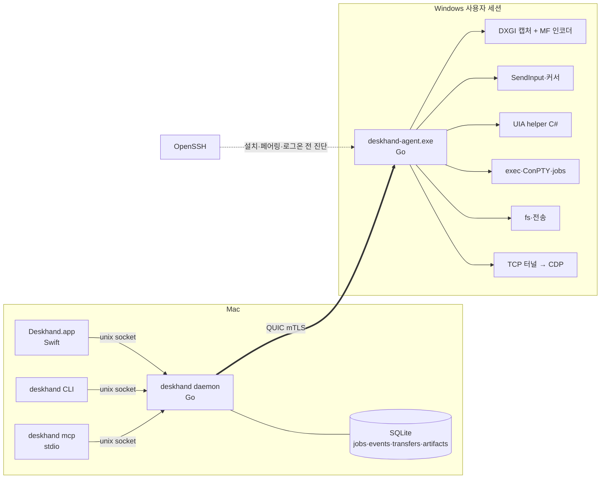

# Deskhand 설계 v1

작성 2026-10-20. 요구사항 원본은 [docs/plan](plan/README.md)이다. 이 문서는 그중 **Jump Desktop 결합을 전제로 한 부분을 대체**한다. 나머지 요구(P0 목록, 상태 모델, 파일 계약, 인수 테스트 A01–A24, 금지되는 완료 판정)는 그대로 유효하다.

## 1. 의도

사람과 AI가 같은 원격 Windows PC를 함께 쓰는 작업 도구를 직접 만든다. 사람은 Mac 앱에서 실시간 화면을 보며 조작하고, AI는 같은 PC를 MCP·CLI로 조작한다. 둘은 같은 사용자 세션과 같은 입력 경로를 쓰며, 입력 주체는 한 번에 하나다. 사람은 언제든 제어권을 가져오거나 AI를 멈춘다. 화면 조작 외에 명령 실행, 파일 전송·이동, 점검, 디버깅, QA 실행을 한 도구에서 한다.

### 사용자 결정

| 결정 | 내용 |
|---|---|
| 이름 | Deskhand. CLI `deskhand` |
| 자체 구현 | 원격 화면 전송·입력을 포함해 우리 손으로 만든다. Jump Desktop, RDP/VNC 클라이언트 등 기성 원격 제품을 핵심 경로에 쓰지 않는다 |
| 실시간 화면 | 화면 캡처·인코딩·스트리밍·표시를 자체 구현한다 |
| 언어 | CLI·공유 코어는 Go |
| 품질 | 현대적 상업용 UI. 적대적 UI 검수를 통과할 때까지 반복 수정 |

### 이 문서에서 내린 판단 (구현자 재량 아님, 변경 시 이 표를 고친다)

| 판단 | 내용 | 근거 |
|---|---|---|
| 오픈소스 라이브러리 | 허용 (quic-go, MCP go-sdk, modernc sqlite, SwiftTerm 등). 기성 원격 *제품*만 배제 | 자체 구현 범위를 프로토콜·제품 동작으로 해석 |
| Windows 에이전트 | Go, Alcove `guest-tools`(MIT, 같은 저작자)를 가져와 확장 | 실행·job·파일·프로세스·UIA가 이미 있고 전송이 `net.Listener`로 분리됨 |
| 화면 파이프라인 | DXGI Desktop Duplication → GPU BGRA→NV12 → Media Foundation H.264(하드웨어 MFT 우선, 소프트웨어 MFT 대체) → QUIC 스트림 → Mac VideoToolbox → `AVSampleBufferDisplayLayer` | cgo·외부 바이너리 없이 Mac에서 교차 빌드 가능, 요청 시 키프레임·비트레이트 변경 가능 |
| 전송 | QUIC(quic-go), ALPN `deskhand/1`, 상호 TLS(인증서 고정) | 다중 스트림·혼잡 제어·TLS 1.3 내장. LAN/VPN 우선이라 ICE/STUN 불필요 |
| Mac 코어 | `deskhand daemon`(launchd 사용자 에이전트)이 연결·제어권·작업 저장을 소유. 앱·CLI·MCP는 unix socket으로 붙는다 | 앱을 닫아도 장기 작업 유지, 세 경로가 같은 상태 공유 |
| Mac 앱 | Swift 6 + SwiftUI/AppKit, XcodeGen(`project.yml`) + SwiftPM 패키지 `DeskhandKit` | Alcove와 같은 빌드 체계 |
| 첫 네트워크 | 같은 LAN 또는 사설 VPN. 방화벽은 `LocalSubnet`으로 제한 | 계획 문서의 LAN/VPN 우선 |
| 첫 대상 | Windows 11 x64 실기기(`ssh windows`, RTX 2070, 3840×2160). ARM64 빌드는 함께 만들되 검증은 Alcove VM에서 보조로만 | 사용자 확정 첫 환경 |
| 로그온 전 동작 | v1은 사용자 로그온 시 시작하는 예약 작업(관리자 권한, 사용자 세션). 로그온 전에는 에이전트 미동작을 `needs_user`로 보고하고 SSH 진단으로 대체. SYSTEM 서비스 + 세션 helper는 P1 | 최소 권한, Alcove 검증 경로 재사용 |
| 디버거 | Chrome DevTools Protocol(Node Inspector·Electron main/renderer) 하나를 P0로 완성. DAP는 P1 | 계획의 "지원 디버거 하나" |
| UI 언어 | 한국어 우선(문자열은 지역화 가능하게 분리) | 사용자 언어 |
| 오디오 | 범위 밖 | 요구사항에 없음 |

## 2. 목표 / 비목표 / 반목표

**목표(P0)**: 계획 01 문서의 P0 요구 전부. 단 CON-02는 "Deskhand 실시간 화면과 AI가 같은 세션을 본다"로 바뀐다.

**비목표**: RDP/VNC 서버 접속 클라이언트, NAT 통과·클라우드 중계, 오디오, 원격 프린터, macOS/Linux 원격(확장 지점만 유지), 전용 IDE.

**반목표 (기술적으로 돌아가도 실패)**
- 사람이 앱을 열어 둬야만 AI 작업이 되는 구조.
- 결과를 모르는 클릭·명령을 재연결 후 자동 재실행.
- 사람이 제어권을 가져왔는데 AI 입력이 어떤 경로(SendInput, UIA, 클립보드)로든 계속 들어감.
- 검증 전 원본을 지우는 move.
- 잠금·UAC·보안 데스크톱을 우회하거나 자동 로그인을 기본 복구로 쓰는 것.
- 무인증 원격 실행 포트, 토큰·비밀번호가 argv·로그·산출물에 남는 것.
- "도구 호출 성공"을 "앱 기능 검증 성공"으로 표시하는 것.

## 3. 구성



### 3.1 저장소 배치

```
deskhand/
  go.mod                       module github.com/YangTaeyoung/deskhand
  cmd/deskhand/                Mac: CLI + daemon + mcp (한 바이너리)
  cmd/deskhand-agent/          Windows 에이전트
  cmd/deskhand-fixture/        Windows 테스트용 Win32 앱 (Alcove alcove-fixture 기반)
  internal/wire/               에이전트↔데몬 프로토콜 타입·프레이밍 (양쪽 공용)
  internal/transport/          QUIC + mTLS, 인증서 생성·고정
  internal/agent/...           에이전트 하위 시스템 (server, exec, jobs, fs, xfer, proc, uia, capture, encode, input, cursor, display, pty, tunnel, diag, session)
  internal/daemon/...          데몬 하위 시스템 (store, hosts, conn, control, observe, xfer, jobs, debug, qa, artifacts, localapi)
  internal/mcpserver/          MCP 도구 정의
  internal/cli/                CLI 명령
  internal/install/            SSH 기반 설치·페어링
  app/                         Mac 앱 (project.yml, Deskhand/Sources, DeskhandKit 패키지)
  scripts/                     빌드·테스트·패키징
  docs/                        design.md, protocol.md, local-api.md, ADR, 인수 결과
```

## 4. 에이전트 (Windows)

- 실행: `C:\Program Files\Deskhand\deskhand-agent.exe`(콘솔 빌드: 사람·SSH·설치 스크립트용)와 `deskhand-agentw.exe`(같은 소스의 windowsgui 빌드, 콘솔 창 없음), 예약 작업 `Deskhand Agent`(ONLOGON, 최고 권한, 대화형)는 `deskhand-agentw.exe run`을 실행한다. 설정 `C:\ProgramData\Deskhand\agent.json`(ACL: Administrators·SYSTEM만 접근 — 에이전트는 최고 권한으로 실행된다), 로그 `C:\ProgramData\Deskhand\logs\`, job 저널 `C:\ProgramData\Deskhand\jobs\`.
- 듣기: UDP 47600(기본), 방화벽 규칙 `Deskhand Agent` remoteip=LocalSubnet.
- 에이전트가 시작하는 프로세스는 사용자의 환경·PATH·AutoRun을 건드리지 않는다(Alcove 교훈). 사용자 세션의 일반 권한 프로세스로 실행할지, 상속 권한으로 실행할지는 요청에 명시하며 기본은 **비승격(사용자 표준 토큰)**이다.
- 하위 시스템
  - `server`: Alcove `internal/server`의 op(exec.run/start/read/write/kill/list, fs.*, proc.*, app.launch, clipboard, display) 이식. 요청 ID 중복 억제(24시간 보존, 저널 영속)와 재시작 후 job 결과 보존 추가.
  - `capture`: 디스플레이별 Desktop Duplication. 정지 화면이면 프레임을 보내지 않는다. Desktop Duplication 불가 시(보안 데스크톱, 원격 디스플레이 어댑터 제약 등) GDI 캡처로 대체하고 그 사실을 capability에 표시한다.
  - `encode`: MF H.264. 하드웨어 MFT 우선, 실패 시 소프트웨어 MFT. 저지연 모드, 목표 비트레이트 실시간 변경, 요청 키프레임, 10초 주기 IDR. 해상도 변경 시 재초기화 후 IDR.
  - `input`: SendInput 마우스(절대 좌표, 가상 데스크톱 기준), 버튼, 휠(정밀 델타), 키(스캔코드 우선), 유니코드 텍스트. 쓰기 권한 세대(writer generation) 검사. 취소·연결 종료·제어권 이동 시 눌린 키·버튼을 모두 해제한다.
  - `cursor`: 포인터 모양(DD `GetFramePointerShape`, 대체: `GetCursorInfo`/`DrawIconEx`)과 위치 스트림.
  - `session`: WTS 세션 ID, 연결 상태, 잠금 여부, 입력 데스크톱(Default/Winlogon) 감지 → `SESSION_LOCKED`, `DISPLAY_UNAVAILABLE`, `ELEVATION_REQUIRED`(UIPI로 높은 무결성 창에 입력 불가) 판단.
  - `uia`: Alcove helper.cs 이식 + 이벤트. 비밀번호 필드 마스킹 유지.
  - `pty`: ConPTY 대화형 터미널, 크기 변경, 재부착(스크롤백 버퍼 보존).
  - `xfer`: 청크 전송, 임시 파일, 재개, sha256, 충돌 정책, 원자적 반영.
  - `tunnel`: 데몬 요청에 따라 `127.0.0.1:<port>`로 TCP 연결 전달(디버깅용). 루프백 외 주소는 거부.
  - `diag`: OS·CPU·메모리·디스크·GPU·프로세스·서비스·이벤트 로그(시간 범위·필터)·크래시 덤프 목록.

## 5. 데몬 (Mac)

- 경로: `~/Library/Application Support/Deskhand/` 아래 `deskhand.db`, `artifacts/`, `hosts/<host_id>/`(인증서), `logs/`. 소켓은 `~/Library/Application Support/Deskhand/run/d.sock`(경로 103바이트 미만 유지).
- launchd 사용자 에이전트 `io.github.yangtaeyoung.deskhand.daemon`. CLI·앱·MCP는 데몬이 없으면 띄운다.
- 책임: 호스트 등록·연결·자동 재연결(지수 backoff+jitter, 취소 가능), `connection_generation` 관리, 제어권 중재, 요청 ID 발급·중복 억제, 작업·이벤트·전송·산출물 영속, 관찰(스크린샷·UI 트리) 캐시와 최신성 판정, 디버거 세션, QA 실행.
- 연결 상태·작업 상태·UI 소유권은 계획 02 §5의 세 축을 그대로 쓴다.

### 5.1 제어권

호스트마다 `owner ∈ {none, human, ai:<client>}`와 증가하는 `writer_generation`을 둔다.

- AI 입력: owner가 none이면 AI lease(TTL 60초, 활동 시 갱신)를 얻고, `ai:<자기>`면 진행, `human`이면 `CONTROL_HELD_BY_HUMAN`.
- 사람 입력: 앱에서 AI 조작 중에 화면을 클릭하면 확인 후 human으로 전환. 전환 순간 데몬은 AI 대기 입력을 버리고 `writer_generation`을 올려 에이전트에 알린다. 에이전트는 이전 세대의 모든 UI 계열 op(입력, ui.act, 창 조작, 클립보드 쓰기, app.launch, debug.electron.launch)를 거부하고 눌린 입력을 해제한다.
- 긴급 정지: owner=human, AI 일시정지(사람이 "AI에게 넘기기" 할 때까지). 이미 실행한 명령은 되돌렸다고 표시하지 않는다. 장기 프로세스 취소는 별도 동작.
- 동시 AI 클라이언트: 입력 writer는 하나. 다른 AI의 입력은 거절, 관찰·로그·명령은 병행.

### 5.2 결과 불명 처리

비멱등 요청(입력, ui.act, exec.start, app.launch, fs 변경)은 요청 ID를 붙여 보낸다. 응답 전에 연결이 끊기면 상태를 `unknown`으로 기록하고, 재연결 후 `req.status`로 에이전트 저널을 조회해 완료/미실행/불명을 확정한다. 확정 전에는 같은 요청을 재전송하지 않는다.

## 6. 화면 스트리밍

- 에이전트: 디스플레이 선택 → 캡처 → 인코딩 → `video` 스트림에 접근 단위(AU) 프레임 기록. 뷰어가 없으면 캡처를 멈춘다.
- 데몬: 에이전트 스트림을 받아 앱의 스트림 연결로 그대로 중계(디코딩하지 않음). 화면을 보는 사람이 없어도 AI 스크린샷은 에이전트 `screen.capture`(PNG/JPEG 정지 영상)로 따로 얻는다.
- 앱: Annex-B → AVCC 변환, SPS/PPS로 `CMVideoFormatDescription` 생성, `AVSampleBufferDisplayLayer`에 즉시 표시. 커서는 로컬 오버레이로 그린다(지연 체감 감소).
- 품질 프리셋: 선명(원본 해상도, 높은 비트레이트), 균형(최대 2560 폭으로 축소), 절약(최대 1920 폭, 낮은 비트레이트). 앱은 fps·지연·비트레이트·손실을 표시한다.
- 지연 측정: 프레임 헤더에 캡처 시각(에이전트 단조 시계)을 담고, 연결 시 시계 오프셋을 RTT로 보정해 캡처→표시 지연을 계산한다.

## 7. 입력

- 앱 → 데몬 → 에이전트. 마우스 이동은 120Hz로 병합, 버튼·키는 순서 보장(단일 `input` 스트림).
- 키보드: macOS 키코드 → Windows 스캔코드 표. Cmd↔Ctrl 매핑은 설정(기본: Cmd를 Ctrl로). 한글: 기본은 키 그대로 보내고 Windows IME가 조합(한/영 키 매핑 제공). 대안 모드 "Mac 입력기 사용"은 확정 문자열을 유니코드로 보낸다.
- AI 텍스트 입력: `unicode`(SendInput KEYEVENTF_UNICODE), `paste`(클립보드 경유, 원래 클립보드 복원), `auto`.
- 입력 결과는 `executed`(에이전트가 주입 완료)와 후속 관찰 결과를 별도 필드로 돌려준다.

## 8. 파일

계획 02 §8의 계약을 그대로 구현한다. 추가 결정:
- 청크 4 MiB, 파일 단위 병렬 4개(측정 후 조정, 임의 제한 금지), 임시 파일 `<대상>.deskhand-part-<transfer_id>`.
- 재개: 에이전트가 임시 파일 크기와 접두 sha256을 보고, 원본 지문(크기·mtime·sha256)이 다르면 `TRANSFER_CONFLICT`.
- 삭제: 기본 휴지통(SHFileOperation FOF_ALLOWUNDO), 영구 삭제는 별도 op.
- 경로: `\\?\` 긴 경로, 예약 이름·대소문자 충돌·junction/symlink 탈출 검사(작업 루트 정책이 있을 때 루트 밖 거부).

## 9. 디버깅

- 터널: `tunnel.open{host, remote_port}` → 데몬이 `127.0.0.1:<임의>`에서 받아 에이전트로 전달.
- Electron: `debug.electron.launch` → 에이전트가 빈 포트 두 개를 골라 `--inspect=127.0.0.1:P1 --remote-debugging-port=P2`로 실행, PID 검증, 데몬이 터널을 열고 main(Node Inspector)과 renderer(CDP target) 목록을 돌려준다. 기존 실행 프로세스 attach는 `debug.attach{pid|port}`.
- CDP 디버거: 중단점(URL 정규식+줄), 일시정지 이벤트, 호출 스택, 스코프 변수(`Runtime.getProperties`), 평가, 재개·한 단계 실행. 소스맵은 P1.
- 세션 종료 시 자기가 연 터널·포트·프로세스만 정리한다.

## 10. QA

- 시나리오 YAML: `name`, `host`, `vars`, `setup`(push, launch), `steps`, `teardown`. 단계: `push`, `launch`, `wait_window`, `click`, `type`, `key`, `ui_act`, `assert_ui`, `assert_screen_text`(UIA 텍스트 기반), `assert_file`, `exec`, `screenshot`, `collect`, `sleep`, `close`.
- 단계 결과: `pass | fail | blocked | not_run`, 각각 증거(스크린샷, UI 스냅샷, 로그)를 산출물로 저장. 입력·UI 계열 단계는 §5.1 제어권을 따르고 사람이 쥐고 있으면 `blocked`(제어권을 가져오지 않는다).
- 결과 묶음: `report.json`(기계 판독, schema_version), `report.md`, `report.html`, `manifest.json`(산출물 sha256).
- 시나리오 형식·단계 값·결과 규칙·결과 묶음의 세부 계약은 [local-api.md §10](local-api.md#10-qa-세부-계약).

## 11. 인터페이스

- 에이전트↔데몬 프로토콜: [protocol.md](protocol.md) (코드: `internal/wire`).
- 데몬 로컬 API(앱·CLI·MCP 공용): [local-api.md](local-api.md) (코드: `internal/daemon/localapi`).
- CLI: 계획 02 §9의 명령 체계를 `deskhand`로 구현. stdout은 데이터, stderr는 진단, `--json`은 schema_version 포함.
- MCP: `deskhand mcp`(stdio). 도구는 로컬 API를 감싸며, 모든 결과에 `host_id`, `session_id`, `connection_generation`, `status`, `action.executed`, `error.code/retryable`, `next_action`, `artifacts`를 담는다(계획 02 §9 JSON 형태).

## 12. 보안

- 페어링: `deskhand host add <이름> --ssh <별칭>` → SSH로 에이전트 설치, 에이전트가 자기 키를 만들고 지문을 출력, 데몬 인증서 지문을 `agent.json`에 기록. 이후 QUIC 상호 TLS에서 양쪽 모두 고정 지문만 허용.
- SSH 호스트 키 검증을 끄지 않는다. `~/.ssh`를 수정하지 않는다.
- 산출물·이벤트에서 비밀번호 필드 값, 토큰을 제외한다. AI에 전달되는 화면·파일 범위는 호스트별 설정으로 제한할 수 있다.
- 터널: `tunnel.open`은 PC의 루프백 서비스(Node 검사기, DevTools 등)를 열려 있는 동안 이 Mac의 `127.0.0.1` 포트로 드러내며, 그 포트에는 인증이 없다(같은 Mac의 어떤 프로세스든 접속할 수 있다). exec를 허용한 에이전트에서만 쓸 수 있고, AI(MCP)도 열 수 있다. 양쪽 모두 루프백에만 묶이며 PC 쪽은 다른 호스트로 연결하지 않는다. 다 쓰면 닫기를 권장한다(`deskhand tunnel close`, `tunnel_close`). 호스트마다 터널 32개, 터널마다 연결 128개, 호스트 전체 터널 스트림 256개로 제한한다.
- macOS 키체인 등 OS 자격 증명 저장소를 쓰지 않는다(키는 권한 0600 파일). 테스트는 임시 HOME을 쓴다.

## 13. Mac 앱

- 사이드바: 컴퓨터 목록(상태 점, OS, 기능 준비 칩), 컴퓨터 추가(SSH 별칭 → 설치·페어링 진행 화면).
- 작업 공간 상단: 컴퓨터·세션, 연결 품질, 제어권 표시(관찰 중 / AI 조작 중 / 내가 조작 중 / 로그인 필요), "제어권 가져오기"·"AI에게 넘기기"·"긴급 정지".
- 탭: 화면, 터미널(SwiftTerm), 파일(로컬/원격 2패널, 드래그 앤 드롭, 전송 큐), 프로세스·로그, 디버거, QA, 타임라인(사람·AI 동작과 증거).
- 설정: 연결, 스트리밍 품질, 키보드 매핑, 파일 작업 루트, 보존 기간, AI 전달 범위.
- 품질 기준: macOS 네이티브 관례(사이드바·툴바·검사기, 키보드 단축키, 다크 모드, 동적 글꼴 크기 대응, VoiceOver 레이블), 빈·로딩·오류 상태 설계, 진행 상황이 항상 보일 것.

## 14. 검증

- Go 단위 테스트(교차 플랫폼), Windows 전용 테스트는 실기기에서 실행(`go test -c` 교차 빌드 후 SSH 실행 또는 Windows의 Go로 실행).
- 실기기 E2E: 페어링 → 연결 → 스트림 → 입력(fixture 앱) → UIA → 명령 → 파일 → 디버그(Electron 테스트 앱) → QA 시나리오 → 산출물 export.
- 인수 테스트 A01–A24 결과를 `docs/acceptance/`에 PASS/FAIL/BLOCKED/NOT_RUN과 증거로 남긴다. 사용자 세션을 끊는 테스트(A10 로그아웃, A21 재부팅)는 사람에게 확인받고 실행한다.
- UI: 화면별 스냅샷(라이트·다크, 빈·로딩·오류 상태)을 렌더링해 적대적 UI 검수자에게 반복 검수받는다.
