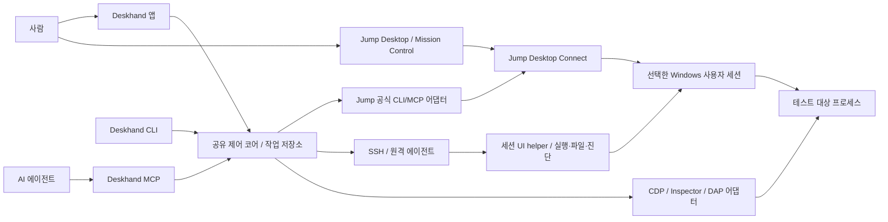

# 02. 환경·구성·인터페이스 설계

이 문서의 구조와 API는 **구현 제안**이다. 실제 제공되는 명령이 아니다. 공식 동작 근거는 [04 문서](04-evidence-and-handoff.md)의 R/E 항목을 참조한다.

## 1. 필요한 환경

| 위치 | 최초 검증 환경/필요 조건 | 설치·확인 사항 |
|---|---|---|
| 제어기 | 현재 macOS, 앱·CLI·MCP를 실행 | Jump Desktop, Jump CLI Beta 후보, SSH, 통합 코어 |
| 대상 | 현재 Windows 11 Pro x64 실기기 | 사용자 세션, 화면 출력 경로, Jump Desktop Connect 버전, SSH 또는 원격 에이전트 |
| 통신 | 기존 LAN/신뢰된 VPN 우선 | SSH 호스트 검증, 인증된 제어 채널, 자동 터널 복구 |
| 파일 | 로컬/원격 작업 디렉터리 | 권한·가용 공간·경로 정책·전송 임시 영역 |
| 개발 대상 | Electron 테스트 앱 + 일반 네이티브 앱 | 빌드/버전·로그 경로·필요 시 소스/심볼·debug 실행 옵션 |
| QA | 격리된 테스트 계정/데이터 권장 | 한글 IME, DPI/해상도 변경 가능 환경, 장애 주입 시나리오 |
| 확장 | Windows ARM64, macOS/Linux 원격 및 Windows/Linux 제어기 | 첫 환경 통과 이후 지원 여부를 별도 검증 |

기존 환경의 정확한 IP/키/비밀값을 제품 기본값에 넣지 않는다. 예시 대상은 `windows-dev` 프로필로 표시한다. 배포 전 지원 OS 최소 버전, 아키텍처, Jump 버전·계정 플랜, 필수 설치 항목을 호환표로 확정한다.

## 2. 권장 구성과 책임



| 주체 | 책임 | 경계 |
|---|---|---|
| 앱·CLI·MCP | 인간/AI 입력, 상태와 결과 표현 | 각자 별도 실행 상태를 소유하지 않는다 |
| 공유 제어 코어 | 대상 식별, capability, 작업/이벤트, 제어권, 재연결, 결과 저장 | GUI 종료로 장기 작업을 잃지 않는다 |
| Jump 어댑터 | 공식 연결·화면·입력·인계 기능 이용 | 비공개 API/프로토콜을 전제로 하지 않는다 |
| 실행/파일 어댑터 | 명령·프로세스·파일 전송·로그 수집 | 화면이 없어도 가능한 작업은 독립 수행 |
| Windows UI helper | 사용자 세션의 UIA·화면·입력 등 부족한 기능 | Session 0 서비스에서 직접 UI 제어 금지 |
| 디버거 어댑터 | 런타임별 연결·로그·스택·중단점 | shell 성공을 디버깅 성공으로 취급하지 않는다 |
| 결과 저장소 | 증거 파일, 메타데이터, 이벤트, 버전 | 토큰·암호·개인 화면의 무분별한 영구 저장 금지 |

Windows 서비스와 사용자 세션 helper 분리는 Microsoft의 세션 모델에 따른 제안이다(R5). 항상 관리자 서비스가 필요하다는 뜻은 아니다. 먼저 일반 사용자 권한으로 충족하고, 부팅/로그온 전 작업 등 필수 요구가 있을 때만 제한된 supervisor를 도입한다.

## 3. 재사용 판단

| 후보 | 역할 후보 | 반드시 확인할 사항 |
|---|---|---|
| Jump CLI Beta / MCP | 기본 화면·입력·디스플레이·사람 인계 | 실제 도구 스키마, 동시 접속/세션 동일성, 앱 창 미표시 상태, 연결 복구, 바이너리 버전 |
| Jump Desktop 연결 링크 | 사람의 연결 진입 | macOS 설치 버전에서 실제 열림, 올바른 프로필/세션; URL에 비밀값 금지 |
| Windows-MCP 0.8.8 | UIA/앱·프로세스·파일·명령 보조 | 반복된 cursor 오류, 표시기 상태 복구, latency, 부작용과 권한 |
| SSH/SFTP 또는 작은 원격 에이전트 | 터미널·파일·프로세스·상태 | SFTP 제공 여부는 실기기 검증; 전송 재개/무결성/작업 재부착은 별도 계약 |
| Alcove 기존 구현 | UI helper·작업 RPC·MCP·진단 패턴 참고 | VM 전용 결합·라이선스·현재 코드 확인; 물리 PC 지원으로 간주하지 않는다 |
| CDP/Node Inspector/DAP | 앱 내부 디버깅 | 대상 앱·어댑터가 지원하는 명령과 버전, 소스/심볼, 프로세스 구분 |

Jump REST API의 팀 관리 기능을 원격 UI 실행 API로 가정하지 않는다. Jump MCP 문서에 없는 파일 전송·UIA·프로세스 명령은 “미확인”으로 표시하고 실제 도구 목록을 읽는다. Jump CLI를 재배포하거나 내장하려면 해당 조건을 확인한다. 검증 전 제품 언어·UI 프레임워크를 고정하지 않는다.

## 4. 단일 대상/세션 모델

- `host_id`: IP와 독립적인 등록 대상 ID. Jump host 식별자와 SSH/agent endpoint를 매핑한다.
- `session_id`: 코어의 작업 세션. 원격 Windows session ID, 사용자 SID, desktop, 연결 세대와 연결한다.
- `connection_generation`: 재연결·로그인 세션 교체 시 증가. 기존 UI 요소/좌표·디버거 핸들을 그대로 재사용하지 않는다.
- `capabilities`: screen/input/uia/exec/files/processes/debug/trace별 `ready | unavailable | unsupported | needs_user`와 reason.
- `job_id`/`request_id`: 장기 작업과 단일 요청 식별자. GUI·CLI·MCP가 공유한다.
- `artifact_id`: 화면·로그·덤프·파일 등의 식별자. 크기/hash/MIME/생성 시각/원본 작업을 포함한다.

Jump와 helper가 동일 사용자 세션을 가리키는지 확인되지 않으면 UI 입력을 시작하지 않는다. 단순 IP 일치만으로 동일 세션이라 판단하지 않는다. 다른 세션으로 바뀌면 새 관찰부터 수행한다.

## 5. 연결·작업·제어권 상태

서로 다른 상태를 한 `connected` 값에 합치지 않는다.

| 종류 | 상태 예시 |
|---|---|
| 연결 | offline → connecting → ready → degraded/reconnecting → ready 또는 blocked |
| 작업 | queued → running → waiting_for_user / reconnecting → succeeded/failed/cancelled/unknown |
| UI 소유권 | idle → ai_control / human_control → idle |

- 연결 단절 시 지수 backoff+jitter와 취소 가능한 재시도를 사용한다. 정상 연결 복구 시간은 측정해 기본값을 정한다.
- 실행 결과가 불명확하면 `unknown`을 반환하고 조회/대조한다. 클릭, 결제/삭제 동작, 앱 실행 등 비멱등 동작을 맹목 재전송하지 않는다.
- 원격 실행의 요청 ID 중복 억제와 결과 보존을 구현한다. 프로세스 재시작 이후 보존 범위와 만료 기간을 계약에 적는다.
- 파일 청크·읽기·상태 조회는 안전하게 재시도 가능한 범위를 구분한다.
- 사람의 takeover/긴급 중지 시 AI 신규 입력을 차단한다. 이미 실행한 명령을 되돌렸다고 표시하지 않는다. 장기 프로세스 취소는 별도 동작이다.
- 동일 desktop의 입력 writer는 하나다. 다른 AI 요청은 큐/거절로 처리하고 화면 관찰·로그 조회는 가능한 범위에서 병행한다.
- Jump의 takeover가 helper/CDP 입력까지 차단되도록 연결해야 한다. 공식 제어권 이벤트를 읽을 수 없다면 별도 경로의 AI 입력을 동시에 활성화하지 않는다. 이 결합은 구현 0단계의 필수 검증이다.
- 잠금·UAC·로그아웃은 `needs_user`/정확한 오류로 알린다. 자동 로그인이나 OS 보호 해제를 기본 복구로 사용하지 않는다.

## 6. 화면·입력 계약

관찰 결과는 `capture_id`, 시각, 화면/창 ID, 실제 픽셀 크기, DPI, 좌표 원점, session/generation을 포함한다. UIA 요소 ID는 관찰 세대에 묶고 stale 여부를 확인한다. 화면이 검거나 정지하면 정상 최신 캡처로 보고하지 않는다.

입력 전에 대상 창·세션·제어권·관찰 최신성을 검사한다. 창이 이동했거나 화면 구성이 바뀌면 재관찰한다. 입력 성공과 후속 화면 관찰 실패는 별도 필드로 반환해 중복 입력을 방지한다. UIA semantic action, 화면 좌표, 앱 내부 DOM 중 사용한 경로를 기록한다. 한국어·줄바꿈·IME 조합·단축키·드래그 중단 시 키/버튼 해제를 검증한다. Windows SendInput은 무조건 모든 권한의 창에 입력 가능한 API가 아니다(R6).

## 7. 명령·디버깅·운용

- `exec`: 명령/argv 또는 명시적 shell, cwd, 환경 참조, stdin/EOF, timeout, detach 정책, stdout/stderr, 종료 코드, 취소, PTY resize, 재부착.
- 인수는 구조적으로 전달한다. 파일명/텍스트를 shell 코드에 이어 붙이지 않는다. 대용량 출력은 파일로 저장하고 cursor 기반 조회/구독을 제공한다.
- app/process: 경로/버전/hash를 확인하고 실행·종료·재시작한다. 자기 작업이 만든 프로세스와 기존 사용자 프로세스를 구분한다.
- logs: 앱 로그·Windows 이벤트·프로세스 종료/크래시를 시간 범위와 필터로 조회한다. CPU·메모리·디스크·서비스 상태는 대상과 샘플 시각 포함.
- Electron: renderer의 DevTools 경로와 main의 Node Inspector를 구분한다(R7). 기존 9222/9229는 사용자 설정 사례이지 전역 고정 포트가 아니다. 자동 충돌 회피·대상 PID 검증·루프백 터널·정리 수명주기를 제공한다.
- DAP: 디버거 어댑터가 제공하는 실제 capability를 따라 attach/launch, breakpoint, stack, variables, continue를 노출한다(R9). 디버그 모드 재실행이 필요하면 기존 프로세스 상태를 알리고 복구 계획을 남긴다.
- Electron Playwright는 실험적 API다(R8). 그것만으로 패키징된 모든 앱이 호환된다고 가정하지 않는다.
- QA 대상 앱의 네트워크 진단은 앱이 제공하는 debug 채널·로그부터 사용한다. 시스템 전체 TLS 인증서 변경을 기본 동작으로 넣지 않는다.

## 8. 파일 전송/이동 계약

1. 로컬/원격 endpoint와 경로, 작업 종류, 충돌 정책, 예상 크기를 지정해 `transfer_id`를 만든다.
2. 전송 전 권한·공간·대상 존재·source fingerprint를 확인한다. 디렉터리는 manifest와 개별 상태를 유지한다.
3. 임시 경로에 기록하고 청크 단위 진행·재개를 지원한다. 최종 크기/hash 검증 후 목적지에 반영한다.
4. 원본이 바뀌면 기존 청크를 무조건 재사용하지 않는다. 충돌을 반환하거나 새 전송으로 전환한다.
5. **move는 목적지 검증 후에만 원본을 제거한다.** 다른 장치 간 이동은 원자적이라고 표시하지 않는다. 원본 삭제 실패는 `copied_source_retained`로 반환한다.
6. 동일 파일시스템 rename도 권한/잠금/경로 조건을 확인한다. rename 실패 시 조용히 copy+delete로 바꾸지 않는다.
7. 덮어쓰기 기본값은 `fail` 또는 UI에서 명시한 정책이다. sync의 삭제 전파는 별도 opt-in이다.
8. path traversal·symlink/junction escape·Windows 대소문자 충돌·예약 이름·긴 경로·한글·공백·이모지·hidden/read-only·잠긴 파일을 처리한다. 플랫폼 메타데이터 보존 범위는 명시한다.
9. 취소 시 완료 파일/미완료 파일/임시 청크를 구분한다. 완료된 데이터까지 임의 삭제하지 않는다. 만료된 임시 파일은 식별 가능한 작업 소유 영역에서 정리한다.
10. 앱 drag-and-drop, CLI, MCP는 같은 전송 작업을 조회·재개한다. shell에 base64 전체를 넣는 방식으로 대용량 전송을 구현하지 않는다.

클립보드의 텍스트 공유와 파일 전송은 별도 기능이다(R3). 드라이브 공유/원격 폴더 마운트는 선택적 어댑터이며 필수 전송 계약의 유일한 구현으로 강제하지 않는다.

## 9. 제안 CLI와 MCP 계약

CLI 이름은 `deskhand`이고 Go 단일 바이너리로 배포한다. 아래 하위 명령은 제안이며 실제 구현 명령은 아니다.

```text
deskhand host add windows-dev --ssh windows
deskhand doctor windows-dev --json
deskhand connect windows-dev --viewer jump
deskhand session inspect <session-id> --json
deskhand ui snapshot --session <id> --window <window-id>
deskhand exec windows-dev --cwd 'C:\qa' -- pwsh -NoProfile -File smoke.ps1
deskhand files push ./build/ windows-dev:'C:\qa\build' --on-conflict fail
deskhand files pull windows-dev:'C:\qa\artifacts' ./artifacts
deskhand files move windows-dev:'C:\qa\old.txt' windows-dev:'C:\qa\new.txt'
deskhand transfer resume <transfer-id>
deskhand debug attach --session <id> --adapter node --process <pid>
deskhand qa run windows-smoke.yaml --host windows-dev
deskhand jobs watch <job-id> --jsonl
deskhand artifacts export <job-id> --output ./results
deskhand mcp serve
```

MCP는 host/session/observe/input/exec/files/transfer/debug/qa/job/artifact를 공통 서비스 호출로 제공한다. 실제 이름/필수 인수는 구현 전에 schema로 확정한다. CLI의 JSON은 버전이 있고 stdout에는 데이터, stderr에는 진단을 출력한다. 비대화 모드에서 사용자 입력이 필요하면 무한 대기 대신 명확한 상태를 반환한다.

```json
{
  "schema_version": 1,
  "request_id": "req-123",
  "job_id": "job-123",
  "host_id": "windows-dev",
  "session_id": "session-123",
  "connection_generation": 4,
  "status": "waiting_for_user",
  "action": {"executed": false, "outcome": "not_started"},
  "error": {"code": "SESSION_LOCKED", "retryable": false},
  "next_action": "human_unlock",
  "artifacts": []
}
```

대표 오류: `OFFLINE`, `AUTH_REQUIRED`, `SESSION_LOCKED`, `SESSION_CHANGED`, `CONTROL_HELD_BY_HUMAN`, `STALE_TARGET`, `DISPLAY_UNAVAILABLE`, `ELEVATION_REQUIRED`, `CAPABILITY_UNSUPPORTED`, `PORT_CONFLICT`, `TRANSFER_CONFLICT`, `HASH_MISMATCH`, `DISK_FULL`, `EXECUTION_OUTCOME_UNKNOWN`.

## 10. 설치·보안·유지보수

- 앱과 CLI는 한 설치/업데이트 흐름을 제공하고 MCP 등록을 안내한다. 사람이 여러 Python 환경·예약 작업·터널을 수동 관리하지 않게 한다.
- 대상 등록은 사용자가 허용한 호스트와 기능 범위에 제한한다. SSH 호스트키 확인을 끄지 않는다. 원격 실행 포트를 무인증 공개하지 않는다.
- Jump viewer 자격증명과 별도 실행/파일 자격증명을 구분한다. 동일 사용자 UX를 제공하더라도 서로의 권한이 자동 승계된다고 가정하지 않는다.
- token/password를 CLI 인수·연결 URL·로그·QA 산출물에 넣지 않는다. 보관/갱신/폐기와 비대화 모드를 설계한다.
- 파일·화면·클립보드·로그를 AI에 전달하는 범위를 대상/작업별로 지정한다. 비밀 입력은 사람에게 인계하고 캡처/이벤트에서 제외한다.
- 설치 버전/계약 버전 불일치는 기능 협상 또는 정확한 업데이트 안내로 처리한다. 서명/무결성 확인, 업데이트 실패 롤백, 제거 시 작업·증거 보존 옵션을 제공한다.
- 재부팅 후 제어 채널 복구와 사용자 로그인 전 UI 불가 상태를 구분한다. UI를 못 해도 허용된 명령·파일 조회까지 함께 죽지 않게 한다.
